<div align="center">

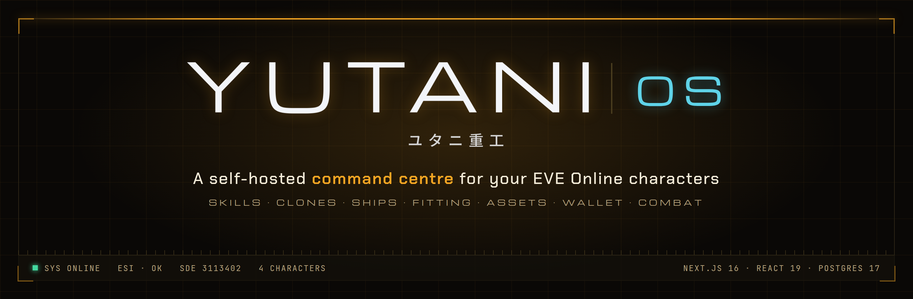

<br>

**A self-hosted command centre for your EVE Online characters: skills, clones, ships, assets and wallet on one site, behind Google sign-in. A native Android app keeps a full copy on your phone and works offline.**

One Next.js app, one sync worker, one Postgres. Pages never call ESI: the worker keeps the database fresh and the pages read from it, so every screen is instant and nothing you click can hit a rate limit.

[](https://nextjs.org/)
[](https://react.dev/)
[](https://www.typescriptlang.org/)
[](https://www.postgresql.org/)
[](https://mantine.dev/)
[](https://developers.eveonline.com/)
[](https://developers.eveonline.com/api-explorer)
[](tests/)
[](deploy/)
[](android/)

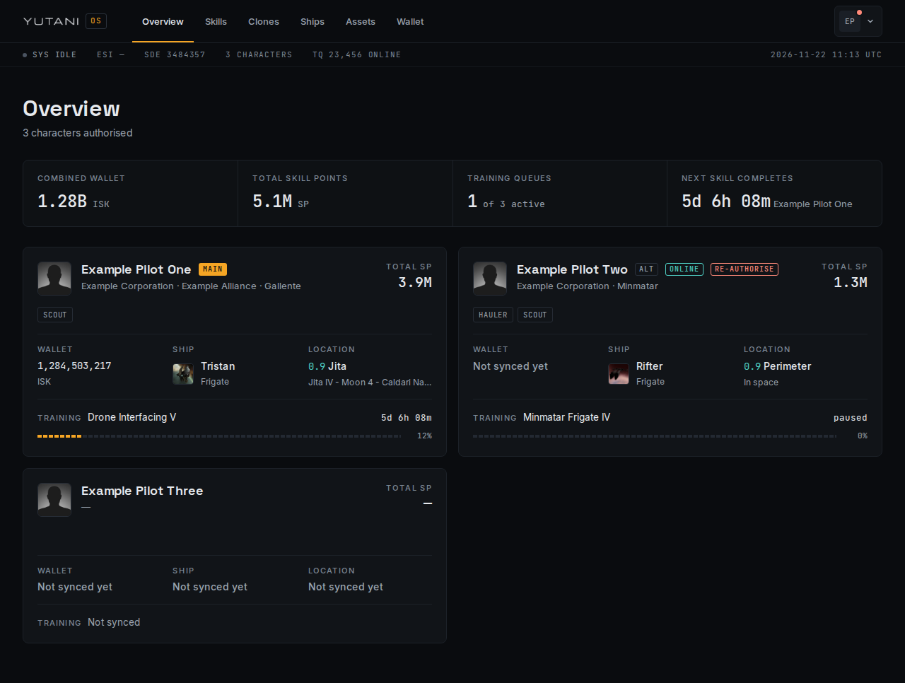

*The Overview. Every character on one screen: who is online, where they are, what they fly, and what is training for how long.*

</div>

---

## Contents

- [What it does](#-what-it-does)
- The screens: [Overview](#-overview) · [Skills](#-skills-and-skill-plans) · [Ships](#-ships-and-fit-sheets) · [Assets, wallet and clones](#-assets--wallet-and--clones) · [Settings](#️-settings)
- [Who gets in](#-who-gets-in)
- [The Android app](#-the-android-app) and [the API it uses](#-the-app-api)
- [Install](#-install) · [Scripts](#️-scripts) · [Deploying](#-deploying)
- [How it works](#️-how-it-works) · [Design](#-the-design) · [Tests](#-tests)

---

## ✨ What it does

You sign in with Google, add your characters with EVE SSO, and the worker syncs them in the background. The site then gives you seven screens:

| | | |
| --- | --- | --- |
| 🏠 | **Overview** | Every character: online status, corporation, main or alt, your tags, wallet, ship, location with its security status, and the skill in training. |
| 🎓 | **Skills** | Every character's training queue side by side, one character's trained skills, the live queue, and **skill plans**. |
| 🧬 | **Clones** | Home station, active implants with their bonuses, and jump clones. |
| 🚀 | **Ships** | Every fitted ship you own and every saved fit, with DPS, EHP, speed, capacitor, CPU and powergrid, missing skills and Jita value. |
| 📦 | **Assets** | Every location as a tree: ships with their fitted modules, containers, blueprints and stacks. |
| 💰 | **Wallet** | Balance, journal and transactions. |
| ⚙️ | **Settings** | Accounts, characters, tags, signed-in phones, the static-data build, and what each sync job last did. |

The **[Android app](#-the-android-app)** shows the same screens, minus Settings, from a copy kept on the phone.

Only Google accounts on your allow-list can sign in. EVE SSO is used afterwards, from Settings, to add each character.

---

## 🏠 Overview

- 👥 **Every character on one screen.** Main and alt badges, tags you define, and a re-authorise badge the moment a token stops working.
- 🟢 **Where they are now.** Online status, the current system with its security status in colour, the station or structure, and the hull.
- 📈 **Training progress by skill points, not by the clock.** The bar shows how far through the level the character is, so it stays right after a queue was paused or edited.
- 📱 **Works on a phone.** At phone width the navigation becomes a strip under the logo and the cards stack in one column.

<div align="center">
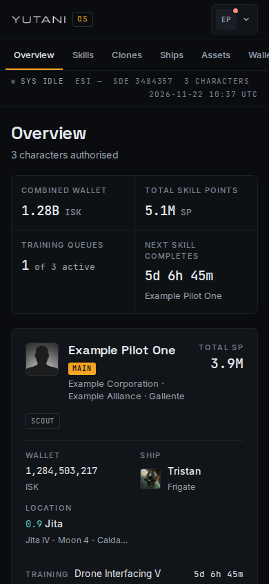
</div>

---

## 🎓 Skills and skill plans

<div align="center">
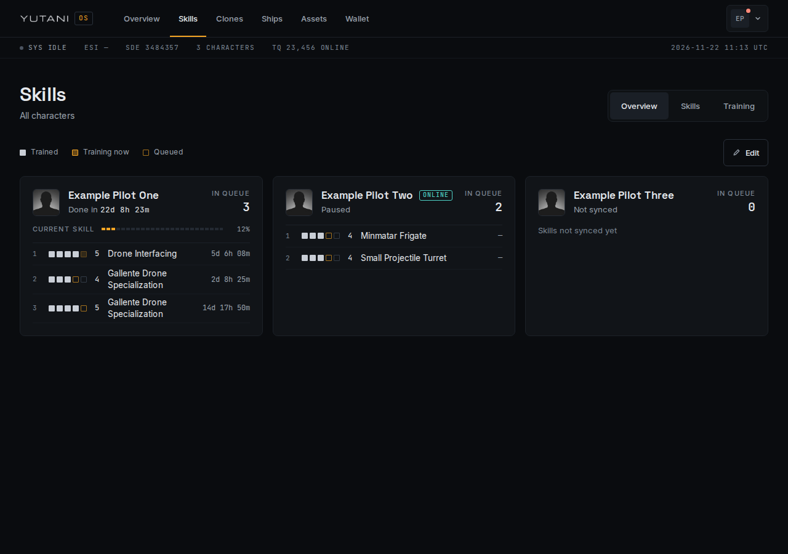

*The Overview tab: every character's queue side by side. The Skills and Training tabs cover one character at a time.*
</div>

The page has three tabs:

- 🧭 **Overview.** One card per character: how many skills are queued, when the queue ends, a progress bar for the current skill and the next entries. Paused and unsynced characters say so. **Edit** chooses which characters appear.
- 🗂️ **Skills.** One character's trained skills by group, with level blocks that mark trained, training and queued levels. The skill's description opens under the row.
- ⏱️ **Training.** The queue with time left per entry and a ticking countdown to its end. Entries that have finished drop out, even while ESI still lists them.

**Skill plans** live at `/skills/plans`, linked from the page:

- 📝 **EVEMon-style plans.** Up to 500 entries, with prerequisites added for you and Alpha-trainable levels marked.
- 🧠 **Optimal remap.** Tries all 2,885 legal attribute distributions and tells you the fastest one and how much time it saves.
- 📥 **Import and export.** Paste a plan from EVEMon or start from one of CCP's forty career plans. Export as EVEMon text or in the in-game skill-plan format.

---

## 🚀 Ships and fit sheets

<div align="center">
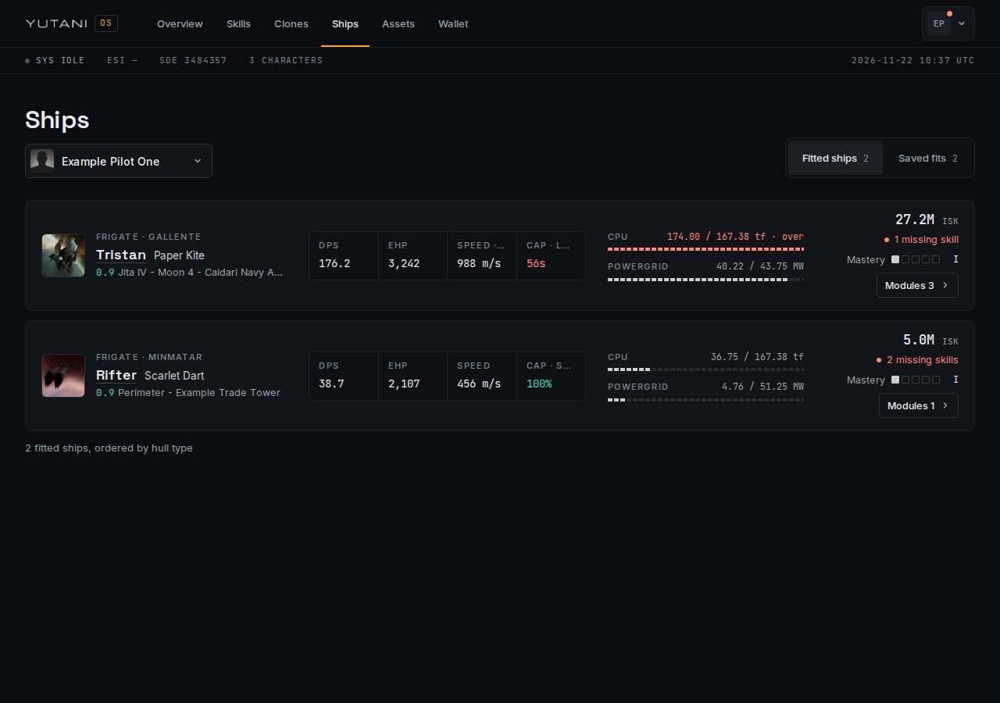

*Fitted ships, straight from your assets. Each card is worked out against the character's actual skills.*
</div>

- 🛰️ **Fitted ships and saved fits** are both shown as cards: render, hull class, location, DPS, EHP, speed, capacitor, CPU and powergrid, missing skills and estimated value.
- 🎯 **Honest numbers.** Until a character's skills have synced, the page says so and treats every skill as level 0, so you see the worst case.

<div align="center">
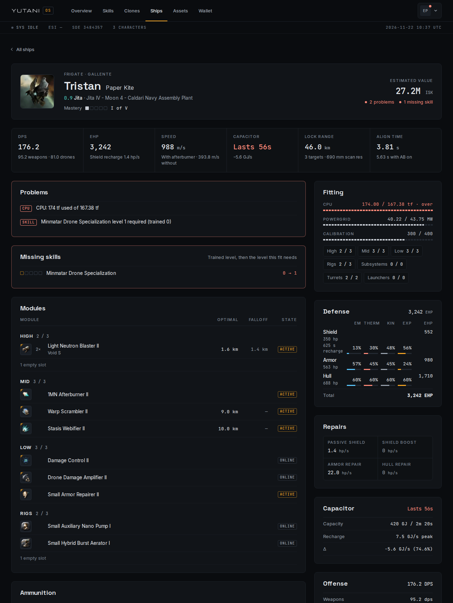

*A fit sheet: one ship in full.*
</div>

- 🧾 **Problems and missing skills** in their own cards: too many modules for the slots, powergrid over, a skill one level short, a drone bay too small.
- 🔍 **Affected by.** Modules and stats can show the skills and modules that changed them.
- 🔫 **Ammunition and drones.** DPS and range for every round in the hold, and a drone selector that updates the figures as you choose what to launch.
- 💎 **Value broken down** into hull, modules, charges, drones and cargo, priced from Jita.

---

## 📦 Assets, 💰 wallet and 🧬 clones

<div align="center">
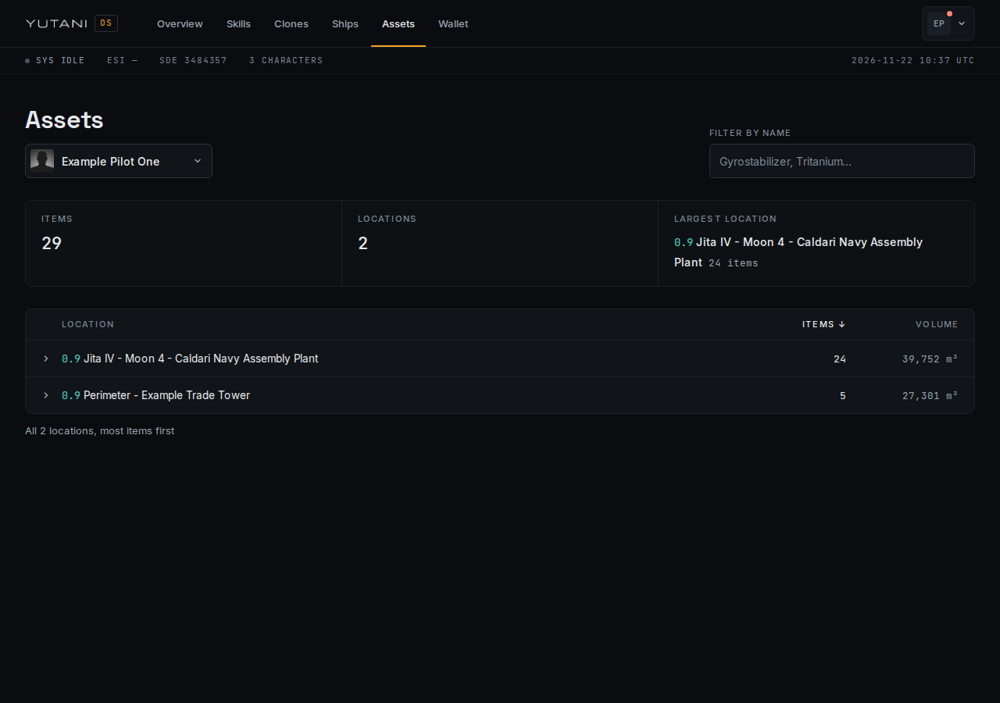

*Assets as a tree. A location opens into its ships and containers, and each of those into what is inside.*
</div>

- 🌳 **Locations, then ships and containers, then items.** Item counts and volume per location, an icon on every row, blueprint copies marked, and a name filter.
- 🏗️ **Player structures are named.** Citadels the character can dock at are looked up through the structures scope.

<div align="center">
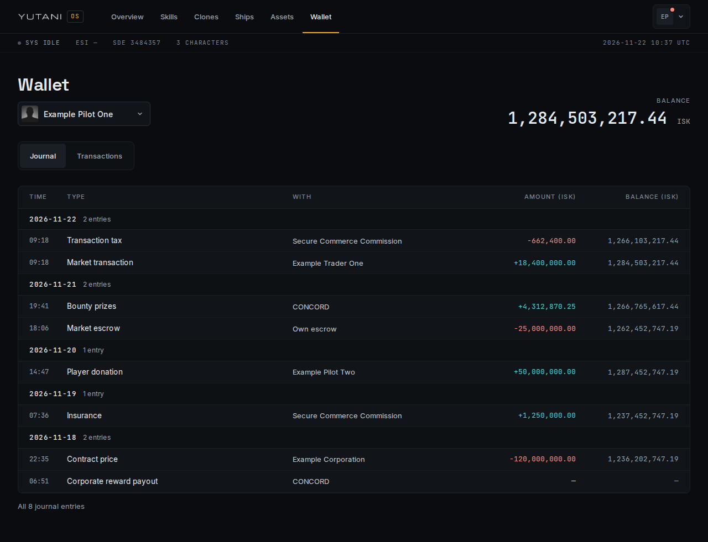
</div>

- 💰 **Wallet.** The balance, the journal with a running balance, and market transactions. Money in is teal with a plus sign; money out is coral with a minus.
- 🧬 **Clones.** The active clone with its implants and the attribute bonuses they give, the home station, and every jump clone by location.

---

## ⚙️ Settings

<div align="center">
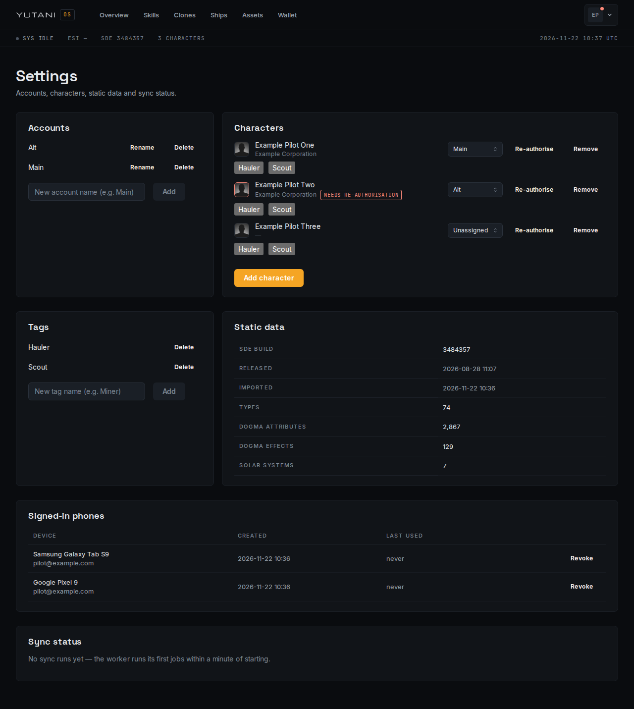
</div>

- 👤 **Accounts and characters.** Group characters under accounts, mark main and alt, add a character, re-authorise one whose token was rejected, or remove one.
- 🏷️ **Tags** you define, shown on the Overview.
- 🗄️ **Static data.** Which build of CCP's Static Data Export is imported, and when.
- 📱 **Signed-in phones.** Every phone running the Android app, when it signed in and when it last synced, with a Revoke button.
- 🩺 **Sync status.** Each job's latest run per character: status, rows and any message. A partial import shows as an amber warning.

---

## 🔒 Who gets in

<div align="center">
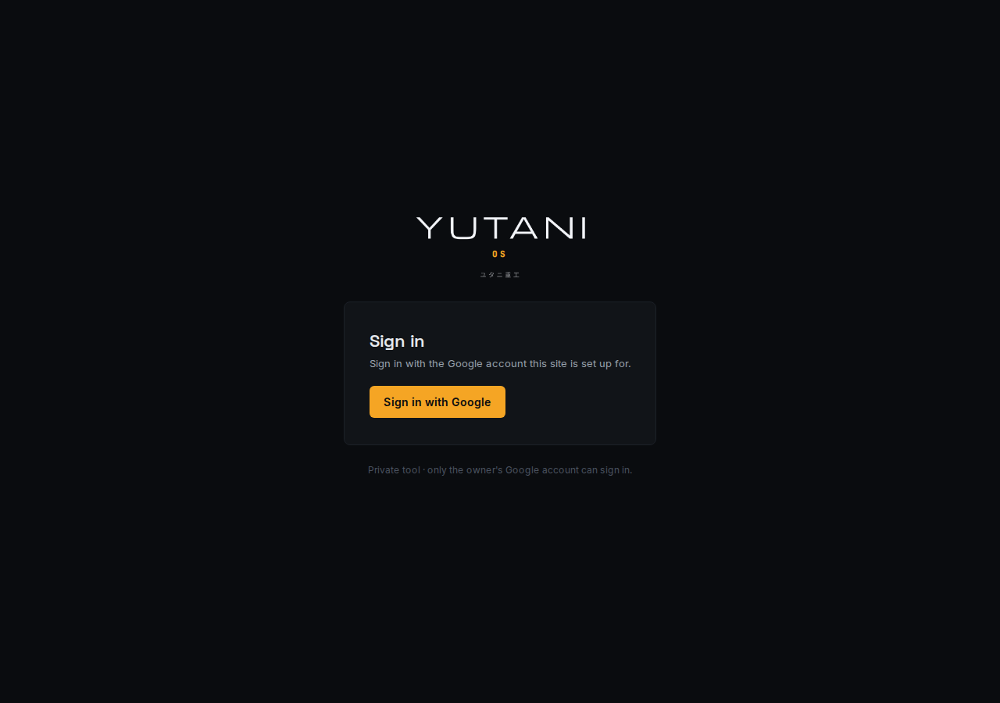
</div>

- 🪪 **Google sign-in is the only way in.** Only the accounts listed in `ALLOWED_GOOGLE_EMAILS` get a session. With an empty list the app refuses to start.
- 🛰️ **EVE SSO only adds characters.** Once signed in, Settings › Add character runs EVE SSO for one character at a time.
- 📱 **Phones use the same Google account.** The Android app trades a Google ID token for its own token, which Settings › Signed-in phones can revoke. Removing an account from the allow-list stops its phones too.
- 🚪 **Everything else is closed.** Without a session, only the login page, the health check, the sign-in routes and the brand images can be reached.

The details, for the curious:

- Both sign-ins use the authorization-code flow with PKCE, and both tokens are verified against the issuer's published keys.
- EVE refresh tokens are encrypted at rest with the session secret.
- Only a SHA-256 hash of a phone's token is stored.

---

## 📱 The Android app

<div align="center">
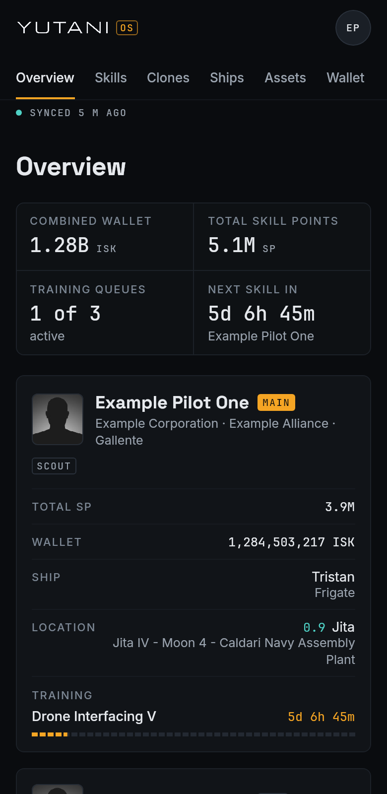
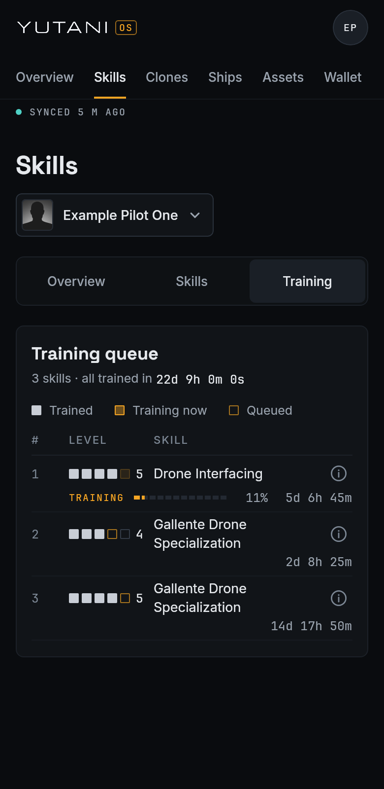
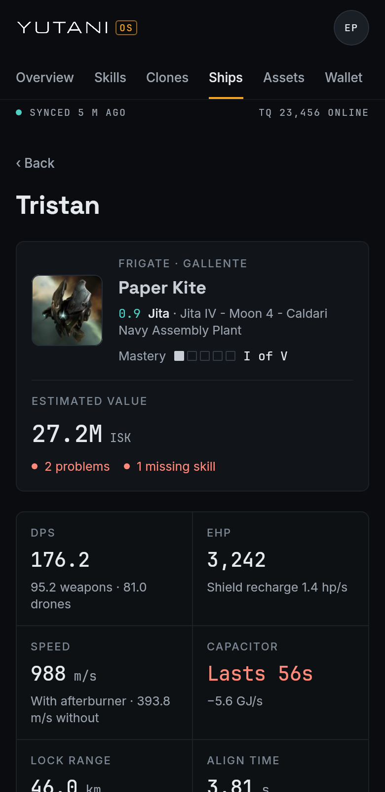

*The app, drawn from the invented characters in the contract fixtures.*
</div>

A native app in [`android/`](android/) (Kotlin Multiplatform, Compose) with the site's look and its read-only screens: Overview, Skills, Clones, Ships and ship detail, Assets and Wallet.

- 📥 **The phone holds everything.** After sign-in it downloads every screen for every character, including ones never opened. Screens open from that copy at once and work with no connection.
- 🔄 **Only what changed.** A sync is one small request for the list of tags, then one request per resource whose tag differs. With nothing new that is a single round trip.
- ⏱️ **Countdowns stay true.** Anything worked out against the clock is recomputed on the phone from raw times, so a day-old copy still counts down correctly.
- 🕐 **When it syncs.** On opening, on pull-down, and about hourly in the background. A strip under the navigation says "Synced 5 m ago" or "Offline · as of 2 h ago".
- 👆 **Swipe between sections**, tap the strip to jump, long-press an item for its description.
- 🧮 **No game maths on the phone.** Fit stats come from the site as finished values; the one exception is the drone selector's sum.
- 🔑 **Google sign-in**, the token encrypted with a key in the Android Keystore, revocable from Settings on the site.
- 🧪 **Checked without a device.** Every screen renders off screen from the contract fixtures (`./gradlew :shared:jvmTest -Pshots=<dir>`).

Building, signing, the one-off Android client in Google Cloud and installing are in [android/README.md](android/README.md).

<div align="center">
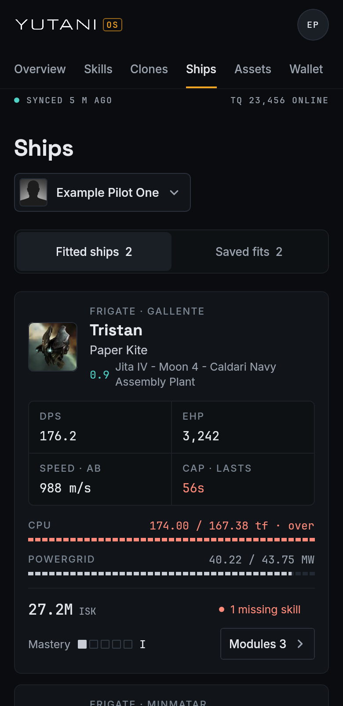
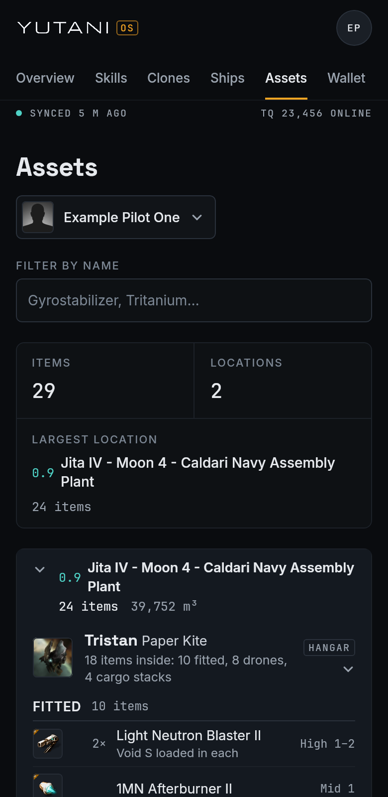
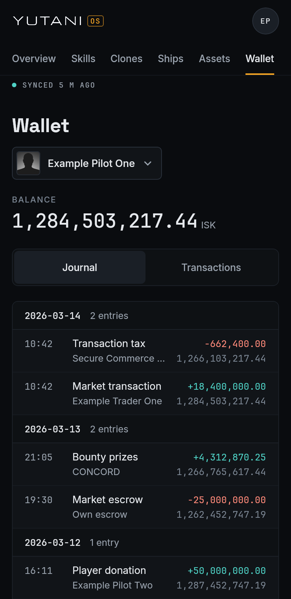
</div>

---

## 📱 The app API

`/api/v1` serves the same view objects the pages draw, as JSON, for the Android app. It reads only; nothing here talks to ESI.

| Route | What it returns |
| --- | --- |
| `POST /api/v1/auth/google`, `DELETE /api/v1/auth/session` | Sign a phone in with `{ idToken, deviceName }`; sign it out. |
| `GET /api/v1/sync` | Every resource a phone should hold, with its current ETag. |
| `GET /api/v1/me`, `/characters`, `/overview`, `/training-overview` | The account, the character switcher, the Overview, Skills › Overview. |
| `GET /api/v1/characters/{id}/skills`, `/training`, `/clones`, `/assets`, `/ships` | One character's screens. |
| `GET /api/v1/characters/{id}/wallet` | The balance; with `?kind=journal\|transactions&offset=&limit=` (at most 500) a slice of that list. |
| `GET /api/v1/characters/{id}/ships/asset/{itemId}`, `/ships/fit/{fittingId}` | A fit sheet, with the per-drone numbers the drone selector sums. |

- 🔑 **Bearer token or the site's cookie.** Without either: `401 { "error": "unauthorised" }`, never a redirect.
- 📦 **`{ data, generatedAt }`**, errors as `{ error }` with 400, 401 or 404. The character is always in the path.
- 🏷️ **ETags that ignore the clock.** Every GET answers `If-None-Match` with `304`. A tag moves when the stored data does, not because a countdown ticked, so anything worked out against the clock also carries its raw timestamps and SP bounds for the app to recompute.
- 🧾 **A contract in the repo.** [`api-fixtures/v1/`](api-fixtures/v1/) holds every response for an invented account and a [README](api-fixtures/v1/README.md) of the shapes. A test fails when a loader drifts from them.

---

## 📦 Install

### Requirements

- **Node 24** and npm.
- **PostgreSQL 17**, or Docker for the bundled dev database.
- An **EVE developer application** from [developers.eveonline.com](https://developers.eveonline.com) with the callback `http://localhost:3000/auth/callback` and the twelve scopes listed in `src/lib/auth/sso.ts`.
- A **Google OAuth client** of type *Web application* with the redirect URI `http://localhost:3000/auth/google/callback`, and the Google account address you sign in with. The Google Cloud steps are in [deploy/README.md](deploy/README.md#google-sign-in-set-up).

### Run it locally

```bash
git clone https://github.com/dc9090-web/yutani-os.git
cd yutani-os
npm ci

cp .env.example .env          # fill in the SSO app, the Google client, the allow-list, a session secret and the database URL
docker compose -f compose.dev.yml up -d     # Postgres 17 on 127.0.0.1:5432, user/password/db all "eve"
npm run migrate               # applies db/schema.sql and the SDE tables

npm run dev                   # the app on http://localhost:3000
npm run worker                # in a second terminal: syncs characters, imports the SDE, pulls prices
```

The first worker tick downloads and imports the SDE, which takes a few minutes. Settings shows "Not imported yet" until it is done. Then sign in with Google, add each character from Settings, and the per-character jobs begin.

### Configuration

| Variable | What it is |
| --- | --- |
| `EVE_CLIENT_ID`, `EVE_CLIENT_SECRET`, `EVE_CALLBACK_URL` | Your EVE SSO application. |
| `GOOGLE_CLIENT_ID` | Your Google OAuth client (type *Web application*). The redirect URI is derived from `EVE_CALLBACK_URL`'s origin plus `/auth/google/callback`. |
| `GOOGLE_CLIENT_SECRET` | That client's secret. |
| `ALLOWED_GOOGLE_EMAILS` | Comma-separated Google account emails that may sign in, compared case-insensitively. Empty stops the app from starting. |
| `OVERVIEW_CHARACTER_IDS` | Which characters the Overview and the Training overview show. Empty means all. |
| `ESI_COMPATIBILITY_DATE` | A date from ESI's published list. Pinned in five places; bump them together and re-run `npm run esi:types`. |
| `ESI_USER_AGENT` | A descriptive user agent with a contact, as CCP asks. The zKillboard client appends the site URL to it. |
| `SESSION_SECRET` | Signs the session cookie and encrypts refresh tokens. `openssl rand -hex 32`. |
| `DATABASE_URL`, `POSTGRES_PASSWORD` | Where Postgres is. |

---

## ⌨️ Scripts

| Command | What it does |
| --- | --- |
| `npm run dev` / `build` / `start` | The Next.js app. |
| `npm run worker` | The sync worker. |
| `npm run migrate` | Apply the schema, idempotently. |
| `npm run sde:import` | Download and import the current SDE by hand, without waiting for the schedule. |
| `npm run esi:types` | Regenerate the typed ESI client from CCP's OpenAPI document for the pinned compatibility date. |
| `npm run sde:fixture` / `dogma:fixture` / `skills:fixture` / `api:sde-extra` | Rebuild the test fixtures from a real SDE. |
| `npm run api:fixtures` | Rewrite `api-fixtures/v1/` from the loaders, against the test database (which it truncates). |
| `npm run app:token -- <email> [device name]` | Create an app session in the database and print its bearer token once, for development. |
| `npm test` | The vitest suite. `npm run test:watch` to keep it running. |
| `npm run typecheck` | `tsc --noEmit`. |

---

## 🤖 Deploying

One script asks the questions and one playbook does the install, on the machine you run it from or on another host over SSH.

```bash
./deploy/setup.sh                                   # subdomain, email, Google account and client, EVE SSO app, Cloudflare token
cd deploy/ansible
ansible-galaxy collection install -r requirements.yml
ansible-playbook -K site.yml                        # first install; later: --tags eve to redeploy the app
```

You need:

- a Debian or Ubuntu host;
- a subdomain whose DNS zone is on Cloudflare, with an A record pointing at the host, and a Cloudflare DNS token;
- an EVE developer application with `https://<your domain>/auth/callback` as its callback;
- a Google OAuth client with `https://<your domain>/auth/google/callback` as its redirect URI.

The stack is three containers (Postgres, the app and the worker) behind Traefik. The certificate comes from Let's Encrypt through a DNS challenge, so it works on a host that is only reachable on your LAN. Only the host's own LAN, Tailscale and the networks you add can reach the site.

The full guide, including the Google Cloud steps and the notes on each background job, is [deploy/README.md](deploy/README.md).

---

## 🛠️ How it works

| | Part | What it does |
| --- | --- | --- |
| ⚛️ | **Next.js 16, React 19** | Server-rendered pages and the JSON routes. One image serves both the web app and the worker. |
| 🟦 | **TypeScript, strict** | The ESI client is typed from CCP's OpenAPI document, pinned to a compatibility date, and regenerated with one command. |
| 🐘 | **PostgreSQL 17** | One schema file, safe to re-apply. CCP's static data lives in `sde_*` tables, so every page is a local query. |
| 🔁 | **The sync worker** | Twelve jobs: four global and eight per character, staggered, with every run recorded and shown on Settings. |
| 📡 | **The ESI client** | Caches by ETag in Postgres, respects each route's rate-limit bucket, slows down when the error budget runs low, and stops calling for a minute after a 502, 503 or 504. |
| 🧮 | **The dogma engine** | A pure library modelled on Pyfa that works out a fit's DPS, EHP, capacitor, speed and targeting from the static data, with stacking penalties. |
| 🐳 | **Docker Compose, Traefik, Ansible** | One playbook provisions a fresh host. |

- **Pages read Postgres, never ESI.** The worker makes every outbound call. A page that cannot reach the database still draws its frame and says so.
- **The twelve jobs.** Global: `sde-update` (6 h), `market-prices` (1 h), `killmail-backfill` (15 min), `killmail-values` (1 h). Per character: `character-info`, `clones` and `fittings` (6 h); `skills`, `assets`, `wallet` and `killmails` (1 h); `location` (15 min). A failed run retries after ten minutes.
- **Prices** come from CCP's reference prices for every type, and from Fuzzwork's Jita aggregates for the types that matter to you: what you own, what is in a fit and what you traded recently. If Fuzzwork is down, the reference prices are used and Settings shows a warning.
- **One loader per page.** Each page's data is built by a function in `src/lib/pages`, which the page and the matching `/api/v1` route both call, so the site and the app cannot drift apart.
- **Two older pages are still in the code but no longer in the navigation:** the fitting designer (linked from Ships › Saved fits) and the Combat killboard at `/combat`, which the killmail jobs feed. Their notes are in [deploy/README.md](deploy/README.md).
- **Design notes** for every phase are in [`docs/superpowers/specs/`](docs/superpowers/specs/), the plans that built them in [`docs/superpowers/plans/`](docs/superpowers/plans/), and the research on the SDE, ESI, the dogma engine and the skill planner in [`docs/research/`](docs/research/).

---

## 🎨 The design

Yutani OS is the sister project of [Yutani](https://github.com/dc9090-web/yutani), the EVE multiboxing tool for COSMIC. The look is clean, dark and easy to read, with a restrained "ship's computer" feel.

- 🟧 **One accent.** Amber marks what is live or selected: the current page, the MAIN badge, the skill in training.
- 🟢 **Two status colours.** Teal for good and coral for bad, always with a word or a sign beside them, never colour alone.
- 🔤 **Three typefaces.** Space Grotesk for headings, Inter for names and text, JetBrains Mono for every number.
- 🧱 **Depth from surfaces, not borders.** The page, cards, sunken cells and open rows each have their own shade.
- 🎛️ **Tokens only, dark only.** Every colour, radius and spacing value is a `--yo-` custom property in one stylesheet.

The full specification, with every page drawn for desktop and phone, is in [`docs/design-handoff/`](docs/design-handoff/). The previous amber-console design is kept in [`docs/design-package/`](docs/design-package/).

---

## 🧪 Tests

```bash
npm test                                   # the site: 1,702 tests in 183 files
cd android && ./gradlew :shared:jvmTest    # the app: 87 tests
```

- **The site's suite** covers both sign-in flows, the app API and its contract fixtures, the ESI client's rate limiting, the SDE importer, the dogma engine against real fits, the skill timeline and remap optimiser, and the React components. The database tests need a Postgres on port 5432; `compose.dev.yml` provides one.
- **The app's suite** decodes the same contract fixtures, runs the sync engine against a pretend site, and swipes through the real app shell.

---

## 📜 Licence

No open-source licence has been applied yet, so all rights are reserved until one is chosen.

EVE Online and all related marks are the property of CCP hf. Yutani OS is a fan-made tool and is not affiliated with or endorsed by CCP.
